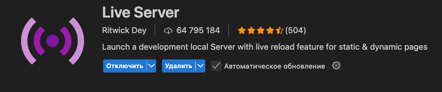

Стартовый набор для выполнения проектной работы Место

Для запуска приложения необходимо использовать live-server

Live-server является расширением VSCode
# Проект: Место (Mesto)

Этот проект представляет собой интерактивную веб-страницу, где пользователи могут редактировать профиль, добавлять фотографии, удалять свои карточки и ставить лайки. Проект реализован с использованием **JavaScript, API и Vite**.

## Функционал
* **Валидация форм:** поля форм проверяются на соответствие заданным правилам (поля обязательны, ссылки должны быть корректными).
* **Работа с API:** данные пользователя и карточки подгружаются с сервера; изменения (редактирование профиля, добавление карточки, удаление, лайки) сохраняются на сервере.
* **Интерактивность:** модальные окна открываются и закрываются, реализована индикация процесса сохранения данных на кнопках.

## Технологии
* HTML5
* CSS3 (Flexbox, Grid Layout)
* JavaScript (ES6+)
* Fetch API
* Vite

## Как запустить проект

Для установки проекта локально:

1. Клонируйте репозиторий:
   ```bash
   git clone [https://github.com/habwu/mesto-ad.git](https://github.com/habwu/mesto-ad.git)
2. Установите зависимости:
   ```bash
   npm install
3. Запустите проект в режиме разработки:
   ```bash
   npm run dev
